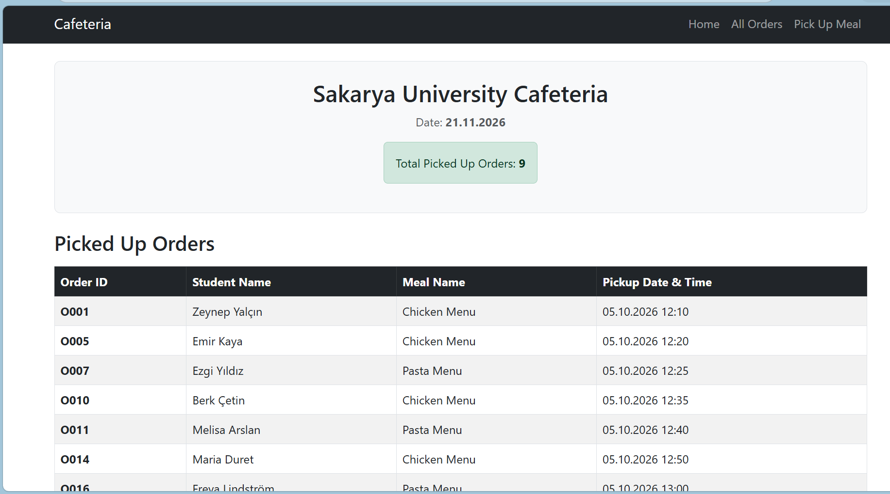
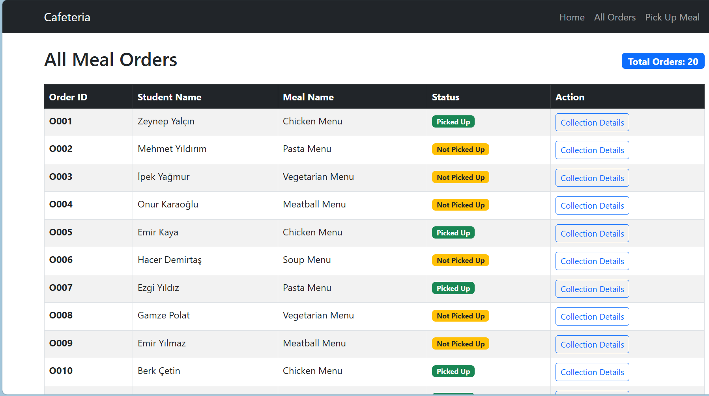
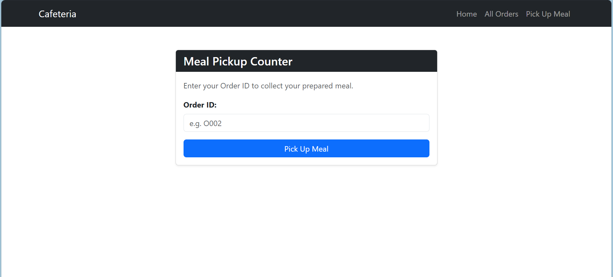

# Meal Order Collection System


A web-based university cafeteria meal order and pickup tracking application built with **ASP.NET Core MVC**.

Developed for the **SWE 203: Web Programming** course at Sakarya University. It simulates distributing prepared meals to students, allowing them to track collection statuses and claim orders using unique Order IDs.

---

## Screenshots

### Cafeteria Dashboard



### All Meal Orders



### Meal Pickup Counter



---

## Key Features

- **Dashboard / Home View (`Home/Index`):**
  - Displays the current date and cafeteria name dynamically via `ViewBag`.
  - Shows a real-time counter for total collected meal orders and lists collected records in a structured table.
  - Provides shared navigation links and a centralized layout footer across all views.

- **Order Catalog (`Order/Index`):**
  - Lists all meal orders (both collected and pending) with `Order ID`, `Student Name`, `Meal Name`, and `Status` (_Picked Up_ / _Not Picked Up_).
  - Displays the total count of registered orders and links each record to its details page via ASP.NET Core Tag Helpers.

- **Order Details (`Order/Info/{id}`):**
  - Resolves order records via route parameter binding (`id`).
  - Displays student and meal metadata along with the exact pickup timestamp or pending status.

- **Meal Pickup (`Pickup/Index`):**
  - Processes order claims by `OrderID`, updating `Collected = true` and recording the pickup timestamp (`DateTime.Now`).
  - Validates missing or invalid order IDs with user feedback.
  - Implements the **Post/Redirect/Get (PRG)** pattern via `RedirectToAction` to prevent duplicate form submissions.

---

## Technical Architecture

- **Framework:** C#, ASP.NET Core MVC (.NET 10)
- **State Management:** Static in-memory data repository (`Repository.cs`) with pre-seeded meal records.
- **Data Transfer & Binding:** `[HttpGet]` / `[HttpPost]` action separation, strongly-typed `MealOrder` model, `ViewBag`, and route/form parameter binding.
- **View Engine & Styling:** Razor Views, Tag Helpers (`_ViewImports.cshtml`), shared layout (`_Layout.cshtml`, `_ViewStart.cshtml`), and Bootstrap 5.

---

## Project Structure

```text
MealOrderCollection/
├── Controllers/
│   ├── HomeController.cs        # Dashboard metrics & collected orders summary
│   ├── OrderController.cs       # Full orders list and order details (Info)
│   └── PickupController.cs      # Pickup form logic & collection handler
├── Models/
│   ├── MealOrder.cs             # Domain entity (OrderID, StudentName, MealName, etc.)
│   └── Repository.cs            # In-memory data store with seed records
├── Views/
│   ├── Home/
│   │   └── Index.cshtml         # Home dashboard
│   ├── Order/
│   │   ├── Index.cshtml         # All orders overview
│   │   └── Info.cshtml          # Specific order details
│   ├── Pickup/
│   │   └── Index.cshtml         # Meal collection form
│   ├── Shared/
│   │   └── _Layout.cshtml       # Global layout & shared navigation/footer
│   ├── _ViewImports.cshtml      # Tag Helper registration
│   └── _ViewStart.cshtml        # Default layout configuration
├── appsettings.json
├── Program.cs
├── README.md
└── MealOrderCollection.csproj
```

---

## Getting Started

1. **Clone the repository:**

   ```bash
   git clone https://github.com/damlameral/MealOrderCollection.git
   cd MealOrderCollection
   ```

   2. **Run the application:**

   ```bash
   dotnet run
   ```
